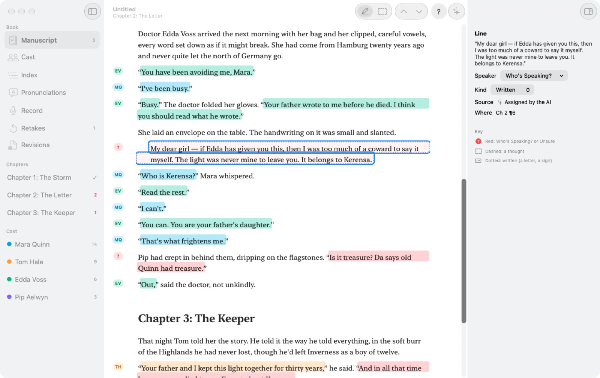
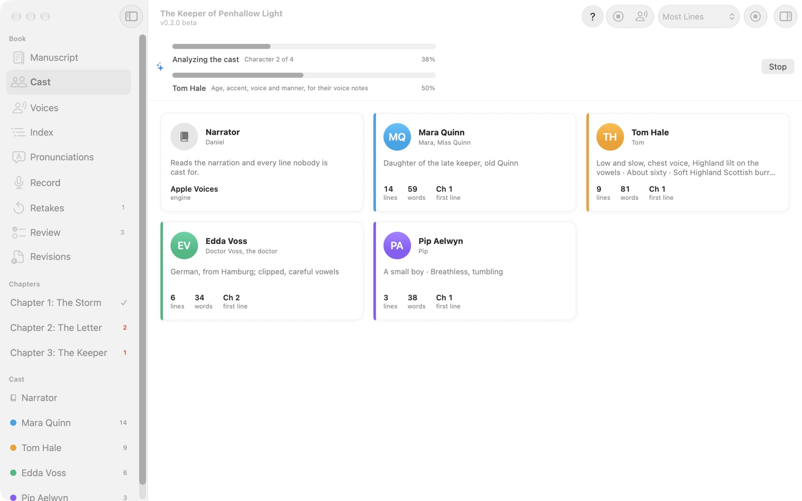
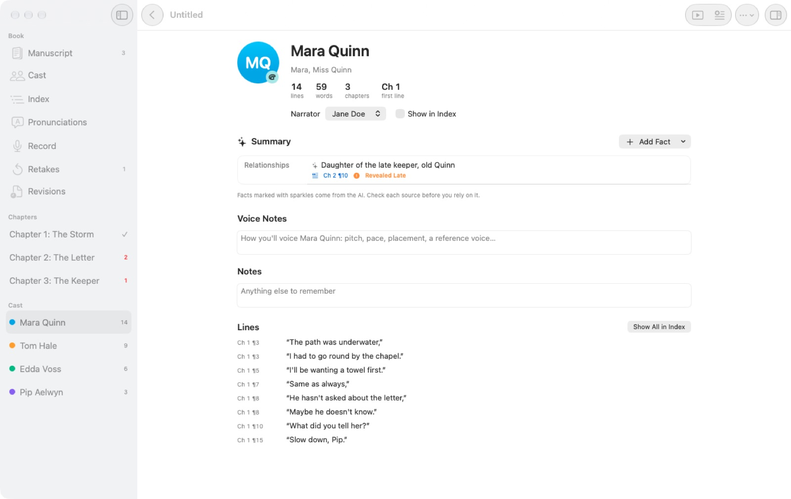
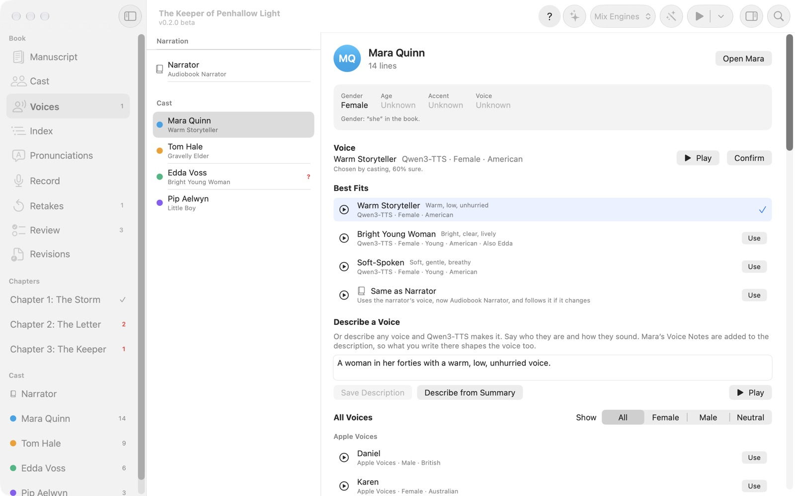
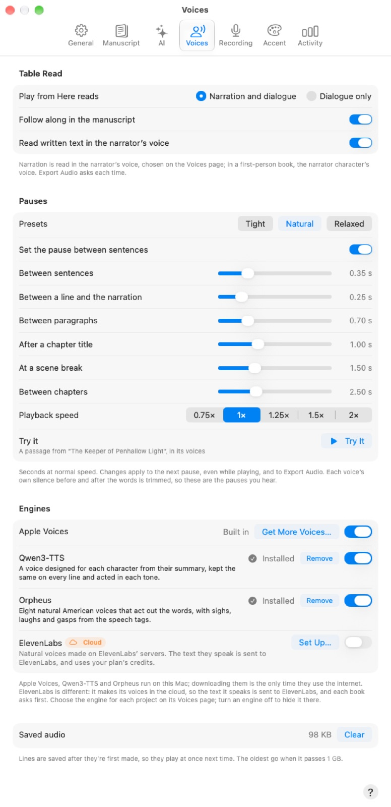
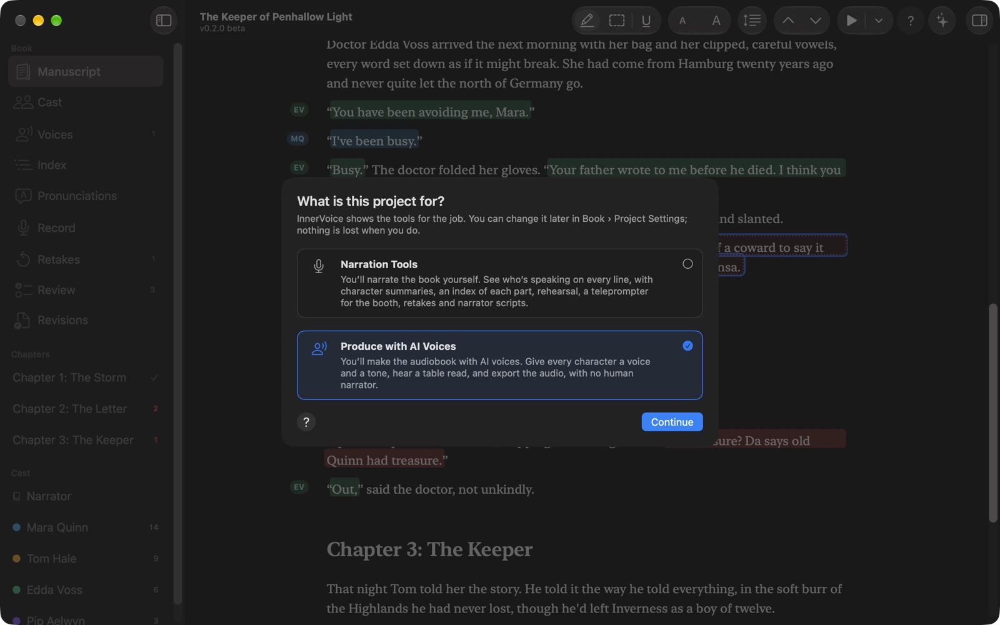
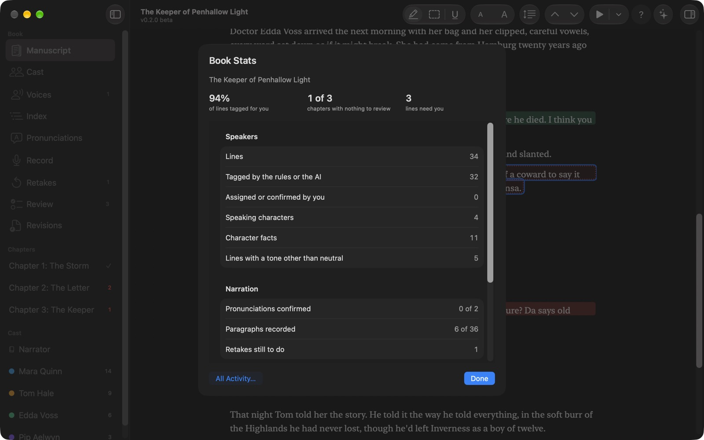
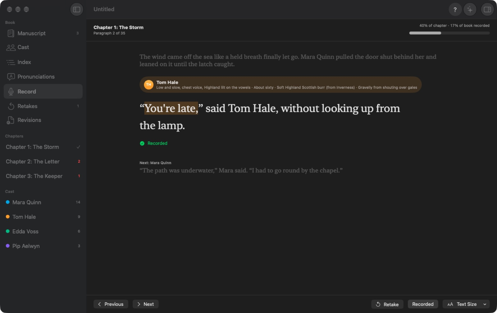
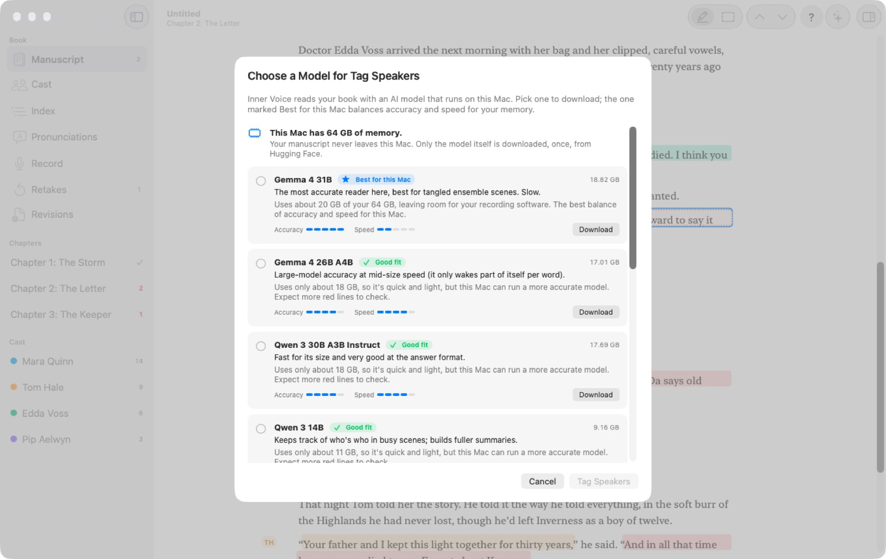

# InnerVoice

InnerVoice helps audiobook narrators prepare a book before they press record, and helps writers turn a book into an audiobook with AI voices. Open the manuscript and an AI that runs entirely on your Mac reads it, colors every spoken line by who says it, and builds a summary of each character from what the book says about them: age, gender, accent, voice, personality, history. When it isn't sure who's speaking, the line turns red with its best guess in the margin ("Cyrus?"), so you can confirm or fix it with a keystroke.

No more highlighter pens, character notes in a separate document, or hunting for a minor character's three lines in chapter 31. Your manuscript stays on your Mac, unless you choose ElevenLabs' cloud voices for a book (InnerVoice asks first).

<p align="center"></p>

## Download

### [⬇ Download InnerVoice for Mac](https://github.com/smanke-org/InnerVoice/releases/latest/download/InnerVoice.dmg)

1. Open `InnerVoice.dmg`.
2. Drag InnerVoice to Applications.
3. Open InnerVoice and drop a manuscript on the Welcome window.

InnerVoice is in beta.

The first time you click Tag Speakers, InnerVoice suggests an AI model for your Mac's memory and downloads it once (2.5 to 19 GB). Requires macOS 26 or later on Apple silicon. Free.

## Features

- **Two kinds of project.** When you open a book, choose what it's for. **Narration Tools** is for narrating it yourself: who's speaking, summaries, the index, rehearsal, the booth teleprompter, retakes and narrator scripts. **Produce with AI Voices** is for making the audiobook with AI voices: a voice and a tone for every character, table reads and audio export, with a guided setup. Each shows only its own tools; switch any time in Book › Project Settings and nothing is lost.
- **Steps that show the way.** A bar across the top of the window walks you from manuscript to finished book: check the manuscript, Tag Speakers, review the lines the AI wasn't sure of (naming new speakers as you go), let the AI read the book again for how each character sounds, then cast and audition the voices and export, or add pronunciations and record if you narrate it yourself. Each step says how far along it is and has one button for what's next; nothing starts until you click. Skip any step, or hide the bar in the View menu.
- **Opens the manuscript you were sent.** Word (.docx and .doc), PDF, RTF, plain text, Markdown, OpenDocument, Pages (with a preview saved), EPUB and HTML. PDF page numbers, running headers and hyphenation are cleaned up. For Google Docs, choose File › Download › Microsoft Word first.
- **Tag Speakers.** Plain rules find every line first ("said Tom", a quote that runs across paragraphs, a two-person back-and-forth, italic thoughts, letters), then the on-device AI decides who speaks the rest. Chapters fill with color while you keep reading; Stop keeps what's done.
- **Your choice of model.** InnerVoice reads your Mac's memory and recommends a model, with a note on every model saying why it fits or doesn't: from a 2.5 GB model for 8 GB Macs to a 19 GB one for 64 GB Macs, or Apple's built-in on-device model with no download. You can also use any GGUF model file.
- **Highlight, outline or underline.** Each character has a color (red is kept for lines that need you). Colors are automatic, blues and greens for men, pinks and purples for women, warm colors until the book says, or choose any color yourself. Thoughts are dashed and written text is dotted, and the speaker's initials, first name or full name sits in the margin, so color is never the only clue. Make the text bigger or smaller right from the toolbar, and read single- or double-spaced.
- **Review the guesses fast.** Review in the sidebar lists every line that needs you, best guesses first, each with the paragraphs around it: Return confirms, typing or 1–9 picks someone else, ↓ moves on. In the manuscript, ⌘↓ jumps to the next one with the guess ready to confirm.
- **Fix lines in a click.** Click a line, type a few letters or press 1–9, and it's assigned; Narration (not spoken), at the top of the same list, takes the color off text no one says aloud. Pin the characters you use most to the top of every speaker list, start typing in the right-click list to find anyone, and right-click a name in the margin to give that speaker's lines in the paragraph to someone else. Fix one line of a back-and-forth and InnerVoice offers to swap the rest of the exchange. Select a passage to assign several lines at once, merge "Mara" into "Mara Quinn", or make a line from text it missed. Everything can be undone.
- **Delete what you won't read.** Select an ISBN, a copyright page or an ad for another book and press Delete, even when it came in as a chapter heading; it leaves the project and every script, and the file you imported stays as it was. Projects save themselves 30 seconds after a change, so you never stop to save.
- **Character summaries you can check.** Each fact the AI finds links to the paragraph it came from, and facts revealed only after a character first speaks are flagged **Revealed Late**, so you know about that Highland accent before chapter 2, not after chapter 20. Edit any fact, add your own, and keep voice notes.
- **Voice notes that write themselves.** Build Summaries on the Cast page reads the book for every character, with a bar for the whole cast, a bar for the character being read, and their name. What it learns about how someone sounds (age, accent, voice, manner) goes into their Voice Notes under "From the book", followed by a **voice brief**: pitch, pace, texture, attitude, and how they should sound different from the characters they share scenes with. Your own notes always come first, and anything you edit is yours. Running it again on the whole cast asks first.
- **Hear every character.** InnerVoice casts a voice for each character from their summary and Voice Notes (gender, age, accent, pitch, pace) and keeps two characters in the same scene from sounding alike. The Voices page plays any voice with the character's own words; speed and pitch fine-tune it. Every line also gets a tone (excited, sad, angry, whispered and five more) from the speech tags and the AI, with unsure ones waiting in Review. Play a line (⌥Space), play a table read from anywhere (⌥⇧Space, with or without narration), hear cue lines in Rehearse, or export the book, a chapter or one character's lines as M4A or WAV.
- **A narrator voice everywhere.** The narrator has a voice of their own on the Voices page, the Cast page, the sidebar and Export Audio, and any character can be "Same as Narrator". Letters and signs are read by the narrator (a setting), thoughts stay in the character's voice, softer, and a first-person book is narrated in the POV character's voice.
- **Four voice engines.** Apple's voices (including the free Premium ones) work right away. Two AI engines that run on your Mac are a download away in Settings › Voices: **Qwen3-TTS** designs a voice for each character from their summary and Voice Notes, so editing the notes changes the voice, and acts every tone in it; **Orpheus** has eight natural voices and performs the sighs, laughs and gasps in the speech tags. **Mix Engines** casts from all of them at once, for a wider range. Turn off any engine you don't want.
- **ElevenLabs, if you choose it.** ElevenLabs' cloud voices (eleven_v4) are the one exception to on-device: set it up with your own API key and a clear yes, and each book asks before any of its text is sent. **Design a Voice from Voice Notes** has ElevenLabs design a new voice from a character's description and notes, shown to you before anything is sent. **Clone a Voice** (Book › Clone a Voice…) makes a voice from a recording of a real person, with their consent, saved under a name you choose in your ElevenLabs account so every project can use it (needs a paid ElevenLabs plan). Everything ElevenLabs is labeled Cloud.
- **Books in a series.** Use Voices from Another Project brings the voices from an earlier book: InnerVoice lists its characters next to who they are in this book (same name, first name only, or not matched), you confirm or change each match, and the matched characters get the same voices, and their Voice Notes if you like, so the series sounds the same book to book.
- **Pauses and speed, tuned by ear.** Set the pause between sentences, after a line, between paragraphs, after a chapter title, at a scene break and between chapters, start from Tight, Natural or Relaxed, and try it at 0.75× to 2× on a passage from your own book. Changes apply while it plays, and to Export Audio.
- **Index.** Every character's lines by chapter, each a link into the book. Main characters start hidden so the index stays short; turn any character on or off.
- **Rehearse.** Step through one character's lines, each with the line before it as a cue.
- **Multi-narrator productions.** Add narrators, cast characters to them, and export a Narrator Script for each one (PDF or Word) with their lines, cue lines and character summaries.
- **Pronunciations.** InnerVoice lists the names, places and invented words it finds. Add how to say each one, mark it confirmed with the author, and record a short sample.
- **Record.** A large-type teleprompter for the booth: one paragraph at a time, the speaker's color and voice cue, the next speaker below. Space or → moves on and marks the paragraph recorded, ← goes back, R marks a retake with a note. Foot pedals that send keys work too.
- **Revised manuscripts.** When the author sends a new draft, import it: tags, notes, recorded marks and retakes stay on every paragraph that didn't change, edited lines keep their speakers, and a Revisions list walks you through what's new.
- **Exports.** The tagged manuscript as a color PDF for print or iPad, Narrator Scripts, the cast list and the pronunciation guide (PDF, Word or CSV).
- **See how much it saves you.** Book › Book Stats shows how much of the book was tagged for you and what's left to review; Settings › Activity counts lines tagged, voices played and exported, time saved (an estimate) and how often each AI model's guesses were kept, on this Mac or all your Macs. Only counts are kept, never anything from a book.
- **Always know what's running.** A bar at the top of the window shows any AI work in the background (Tag Speakers, Build Summaries, voice briefs, a voice engine loading), with Stop. The version is on the Welcome window and under the book's name.
- **The usual comforts.** Light or dark appearance, menu bar and Dock icons you can hide, Ask before quitting, settings that follow you to your other Macs, updates from GitHub, ToolHUD and ShortcutsLens support, and Help built in (⌘?).

## Screenshots

<table>
<tr>
<td width="50%"><br><sub><b>Build Summaries.</b> The whole cast, one character at a time.</sub></td>
<td width="50%"><br><sub><b>Characters.</b> Voice, summary and Voice Notes on one page.</sub></td>
</tr>
<tr>
<td width="50%"><br><sub><b>Voices.</b> Mix engines, or describe any voice.</sub></td>
<td width="50%"><br><sub><b>Pauses.</b> Tune the gaps by ear, at any speed.</sub></td>
</tr>
<tr>
<td width="50%"><br><sub><b>Project types.</b> Narrate it yourself, or produce it with AI voices.</sub></td>
<td width="50%"><br><sub><b>Book Stats.</b> What's done and what's left.</sub></td>
</tr>
<tr>
<td width="50%"><br><sub><b>Record.</b> A teleprompter for the booth.</sub></td>
<td width="50%"><br><sub><b>Models.</b> Recommended for your Mac's memory.</sub></td>
</tr>
</table>

## Privacy

InnerVoice reads your manuscript with a model running on your Mac, and Apple Voices, Qwen3-TTS and Orpheus speak it on your Mac too. Nothing in the book is sent anywhere, with one exception you choose: ElevenLabs. It's off until you add your own ElevenLabs key and agree that text goes to ElevenLabs, and then each book asks before its text is sent; the lines its voices speak, and the descriptions for any voice you design, go to ElevenLabs' servers. Stop Sending This Book ends it for a book. The only downloads are the models you choose (once, from Hugging Face) and InnerVoice's own updates (from GitHub).

## Updates

InnerVoice checks GitHub for new versions (you choose how often, or turn it off, in Settings › General) and can install them for you.

## Building

```bash
Tools/fetch_llama.sh        # the pinned llama.cpp framework (once)
./build.sh                  # .build/app/InnerVoice.app
swift test                  # unit tests
tools/selftest.sh           # in-app self-test on the sample book
```

## License

© 2026 Steve Manke. All rights reserved.
